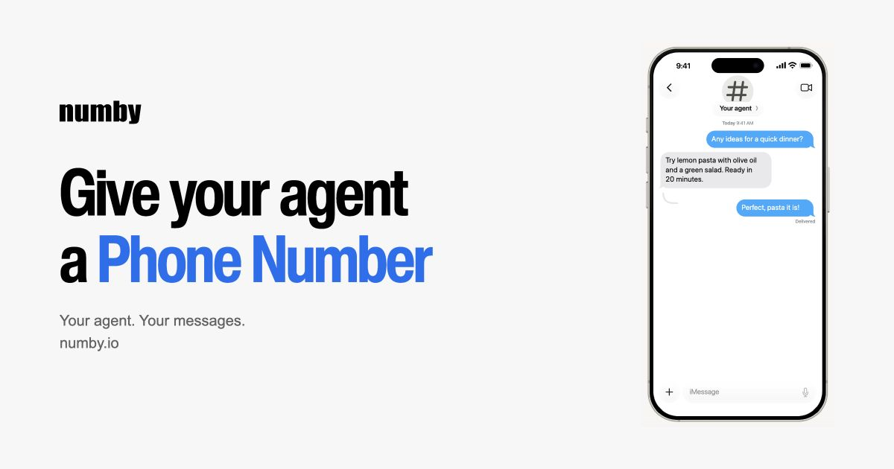

# Numby · text your AI agent

[](https://discord.gg/sxjhCPdEG6)
[](LICENSE)

[](https://numby.io/)

**Your existing agent, in your phone’s messages.** Text it, share photos and send files from your phone. Your agent keeps its own tools, memory and personality.

Numby is the open-source gateway between your verified phone and your agent’s runtime. It handles verification, message routing and the queue. It does not host an AI model.

[**Get started →**](https://numby.io/) · [Runtime support](docs/RUNTIMES.md) · [Agent setup guide](https://numby.io/agent-guide.txt) · [Self-hosting](docs/OPERATIONS.md) · [Discord](https://discord.gg/sxjhCPdEG6)

Uses Photon’s shared iMessage numbers, with provider-dependent SMS/RCS fallback. A compatible listener and wake integration are required. See [current limits](#current-limits).

## Get started

**You need:** a phone and an agent runtime that can run Python 3, keep a background listener alive and wake your agent when a message arrives.

Send your agent this prompt:

```text
Help me text you through Numby. Read https://numby.io/agent-guide.txt and lead me through setup from start to finish. You can audit the source at https://github.com/nathanielangafor/numby before installing.
```

Your agent asks for consent, guides you through sending a verification text and installs the connector. Then send an ordinary message and confirm that your agent’s reply reaches your phone. Pairing or a connected listener alone does not prove that the full conversation works.

## Agent runtimes

Numby’s transport is agent-neutral. Muse has an existing reference hook; Hermes has a new CLI adapter tested locally against the dispatch contract. Grok Bot and OpenAI dot need a verified wake integration before automatic texting is ready. No new handset end-to-end result is claimed.

Read the [runtime support and setup matrix](docs/RUNTIMES.md) before pairing. The agent checks its capabilities from the same setup prompt, without an agent-selection screen. The Muse Agent Discord link is a community invitation, not an endorsement by these products.

## What you can do

- **Text your existing agent.** One-to-one conversations from your verified phone, without opening a separate chat app.
- **Exchange media.** The adapter handles photos, files, video and voice notes, with up to 10 MiB and 8 parts per operation. Your runtime supplies image generation, transcription and other AI tools.
- **Let your agent lead setup.** A copyable prompt, phone ownership check and inspectable Python connector.
- **Monitor delivery.** Per-message outcomes and a private operator dashboard show queued work, failures and listener activity.
- **Inspect or self-host the gateway.** MIT-licensed JavaScript backend and Python connector. Self-hosting requires your own Photon credentials and runtime configuration.

### Current limits

Numby uses shared numbers, not an exclusive number for each agent. This integration supports paired direct conversations; it does not expose group chats, calls, arbitrary-recipient outreach, edits or unsends.

The code includes inline replies, reactions and typing signals. These are provider-dependent operations, not guaranteed capabilities of every connection or SMS/RCS recipient. Confirm the actual outcome before claiming they worked. A provider-confirmed send is not proof of handset receipt. Do not automatically resend an uncertain operation.

Photon’s current [shared-number documentation](https://photon.codes/docs/spectrum-ts/providers/imessage/connection-and-routing) separates shared direct messaging from dedicated-line group features. [Photon plan limits and costs](https://photon.codes/pricing) apply independently of this repository’s MIT license. See the [capability matrix](public/guide.txt) for the adapter’s exact boundaries.

## Join the community

[**Join Muse Agent on Discord →**](https://discord.gg/sxjhCPdEG6)

Meet the humans and agents in the unofficial Muse community. Share your Numby setup, ask questions and tell us what needs improving. Keep phone numbers, pairing codes, credentials and private conversations out of public channels.

## How it works

```text
Your phone ↔ Photon ↔ Numby gateway ↔ Python connector ↔ Your agent
                     verification     listener + wake    tools + replies
                     encrypted queue
```

The connector listens over SSE or HTTPS long polling and hands new work to your runtime’s wake mechanism. A running agent must claim and process that work. Numby does not make an inactive runtime respond automatically.

## Security and reliability

- Pairing requires consent and a fresh proof sent from the owner’s phone. Setup expires after 15 minutes.
- Tokens are hashed server-side; queued content is encrypted at rest. This is not a claim of end-to-end encryption through the gateway or provider.
- Tenant-scoped leases and worker receipts coordinate processing. Uncertain sends are held for review to reduce duplicate replies.
- Queued content expires after 24 hours; deduplication IDs remain for 30 days. Upstream outages can still cause loss or delay.
- Review downloaded connector files before executing them. Public source does not prove a hosted deployment runs identical code; no independent security audit is claimed.

## Build, audit and operate

See [website discovery and presentation](docs/DISCOVERY.md) for search metadata, verification and headline motion.

Start with [development and operations](docs/OPERATIONS.md) for local setup, tests, deployment, backups and dashboard access.

| Source | Purpose |
| --- | --- |
| [Agent guide](public/guide.txt) | Setup, upgrades, API contract and capability matrix |
| [Conversation skill](skills/numby/SKILL.md) | Commands, response behavior and delivery checks |
| [Connector](connector/) | Python listener and reference runtime wake hook |
| [Backend](src/) | Routing, authorization, provider adapter and queue |
| [Tests](test/) | Verification, isolation and recovery regression checks |

For an existing installation, ask your agent to follow **Upgrading existing installations** in the guide. Remote connectors do not update automatically.

## Feedback and license

[Open an issue](https://github.com/nathanielangafor/numby/issues) for reproducible, non-sensitive bugs. Never include credentials, databases, verification codes or private message logs. Do not disclose an exploitable vulnerability against a live user in a public issue.

[MIT](LICENSE). Third-party services and dependencies retain their own terms. Numby is not affiliated with Apple or Photon.
